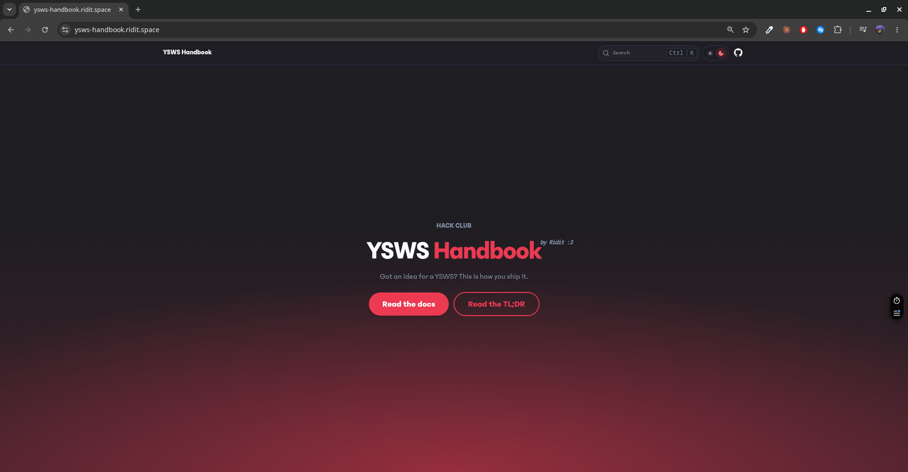

# YSWS Handbook



A complete handbook on *How to start a YSWS* (You Ship, We Ship) program at Hack Club!
Its not a guide, not a rule book, not some instructions, its just pure advice and it gives you some idea on what things will happen, how you can create websites, and my experience, all into 1 handbook :)

Its written by [Ridit](https://hackclub.enterprise.slack.com/team/U0ARC79GEAV) (me), and I have experience running YSWS programs, I have ran 2 YSWS soo far!

> Don't wanna read the whole docs? Read the [TL;DR](https://ysws-handbook.ridit.space/docs/tldr)

The documentation template is generated by [Fumadocs](https://www.fumadocs.dev/) and the whole website is in Hack Club [Branding](https://hackclub.com/brand).

## What's inside

| Page | What it covers |
| --- | --- |
| Welcome | What this handbook is |
| Before You Start | What a YSWS is and what happens behind the scenes |
| From Idea to Pitch | Turning your idea into a real pitch |
| RSVP | What an RSVP is and why you need it |
| Create Your Website | Building the basic structure of your YSWS website |
| Vibecoding Your Website | Can you vibecode your website? If yes, how? |
| Ads | Posting ads for your YSWS |
| Sponsor | Finding a sponsor and getting your YSWS off the ground |
| After Sponsor | You got a sponsor (or a DM from a gappie), so what now? |
| TL;DR | The whole handbook, short |

*More coming soon!*


## Example websites

`ysws-website-examples/` has four sample YSWS landing pages built with [Astro](https://astro.build). The **Vibecoding Your Website** page links to them. Each one is a standalone project:

```bash
cd ysws-website-examples/example-1/sample-website
npm install
npm run dev
```

> Don't wanna run it? you can look at the generated result [here](https://ysws-handbook.ridit.space/docs/vibecoding-your-website#deciding-a-theme)

## Running the handbook locally

The website uses [Next.js](https://nextjs.org) and [Fumadocs](https://fumadocs.dev).

```bash
bun install
bun dev
```

Then open http://localhost:3000.

Other scripts:

```bash
bun run build        # production build
bun run lint         # eslint
bun run types:check  # typecheck
```


## Contributing

Found something wrong or have your own YSWS experience to add? PRs are welcome.

To add a page:

1. Create `content/docs/<slug>.mdx`:
   ```mdx
   ---
   title: Your Page
   description: One-line summary
   ---
   ```
2. Add `<slug>` to `content/docs/meta.json` where it should appear in the sidebar.
3. Put images in `public/screenshots/` and videos in `public/recordings/`.

Please keep the tone casual and first person like the rest of the handbook is.

## License

[MIT](LICENSE)
